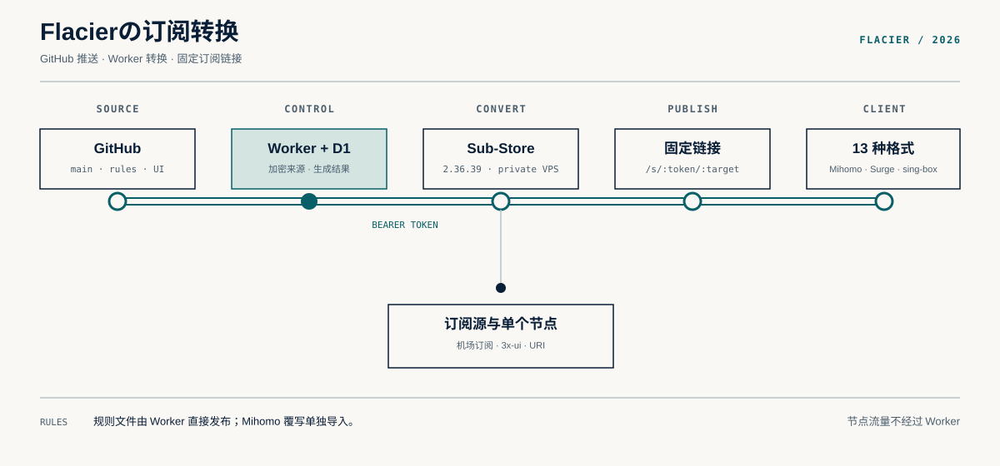

<h1> Flacierの订阅转换</h1>

个人订阅转换、分流规则和网址测试。

[在线页面](https://rules.flacier.com/) · [Mihomo 覆写](https://rules.flacier.com/overrides/clash-party.yaml) · [规则目录](public/rules/manifest.yaml)



## 功能

- 合并多个订阅和单节点，生成 KV 短链接
- 客户端刷新时读取上游并转换，链接不用重新生成
- Clash Verge、FlClash、Clash Party、Mihomo 等完整配置；Shadowrocket 配套的节点订阅与原生 `.conf`
- 节点筛选、多重改名、国旗、类型、UDP、XUDP 与排序
- 透传、合并上游流量与到期信息
- 独立 HTTP／HTTPS／SOCKS5 代理字段录入、备注；多机场来源名称与剩余流量
- 刷新失败时保留 24 小时内的完整有效输出，不用空节点替换
- 继承独立的原订阅 DNS，或配置节点引导 DNS 与代理 DoH；Mihomo IPv6 默认关闭
- CF、本地及自定义 Flacier 后端；ACL4SSR 和自定义远程规则模板
- BrowserLeaks、IPv6、Cloudflare 网络检测入口
- AI、Apple、Steam、Discord、Bilibili、AniGamer 等分流规则
- 按 Flacier、ACL4SSR 或自定义模板测试规则；缺少 IP、进程或地理规则数据时明确提示无法确定
- 规则格式转换；页脚构建时间、版本时间与提交 hash

规则文件位于 [`public/rules`](public/rules)，Mihomo 覆写单独导入：

```text
https://rules.flacier.com/overrides/clash-party.yaml
```

## 开发

```bash
pnpm install
pnpm dev
pnpm check
```

开发时另开终端运行 `pnpm dev:worker`（仅本地 8789 端口）；Vite 的 API 请求会转到该 Worker，不使用其他项目的 8787 端口。

部署使用 Cloudflare Git 集成，见 [Cloudflare 配置](docs/cloudflare-setup.md)。

本地转换：`pnpm build && pnpm start:local`，打开 `http://127.0.0.1:25500`。如需通过已运行的代理客户端下载上游，可给本地服务传入 `--proxy http://127.0.0.1:混合端口`；只影响该进程，不修改系统代理。用量、DNS 与手机端说明见 [客户端配置](docs/clients-and-dns.md)。

Rola 住宅出口：网页选择「机场 → Rola 家宽出口」，由 Cloudflare 生成；账号密码通过 HTTPS 提交并保存到 KV，客户端持续刷新时自动续期，90 天无刷新才失效，生成后下载管理文件可删除记录。选择前置加密节点、编辑家宽备注、域名规则和 DoH；可显式上传固定快照，但快照没有自动更新节点和用量的能力。另有独立限时回退工具。生成不切换客户端，Rola 与机场额度不相加。见 [Rola 接入与验收](docs/rola-residential.md)。

`/sub` 兼容入口支持 Clash/Mihomo 请求、`list`、筛选、排序、国旗、类型、UDP/TFO、证书选项、ACL4SSR INI 和规则展开；未知或不支持的参数返回明确错误，不返回 HTML 冒充配置。其他客户端使用本站界面。见 [本地与云端转换、刷新保护](docs/subscription-refresh.md)。

## License

[AGPL-3.0](LICENSE) · [Third-party notices](THIRD_PARTY_NOTICES.md)
